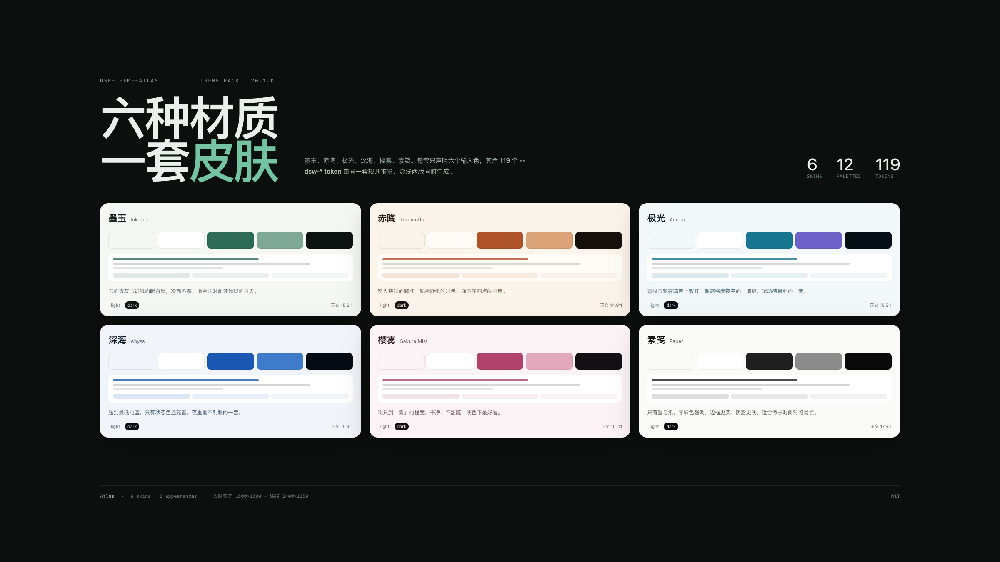

# dsh-theme-atlas

**Six material skins for the DeepSeek Harness Web GUI — one token engine, light and dark, switched from inside the app.**

[中文说明](./README.zh.md) · [Theme document](./docs/themes.md) · [Palette reference](./docs/palettes.md) · [Image sizes](./docs/images.md)



Atlas is a theme *pack*, not a single recolour. Each skin declares six input colours per appearance; the engine derives the 119 `--dsw-*` alias tokens the Web shell reads from them, then measures the result. Six skins × two appearances = twelve palettes that all share the same semantic rules, so a state that reads in light mode reads in dark.

## The six skins

| Skin | Material | Accent light / dark | Body contrast | Preview |
| --- | --- | --- | --- | --- |
| **墨玉 Ink Jade** | 和田青玉 · 宣纸 / Hetian jade on rice paper | `#2E6B57` / `#74C3A2` | 15.6:1 / 16.0:1 | [light](./assets/screenshots/01-ink-jade-light-1600x1000.png) |
| **赤陶 Terracotta** | 未上釉的陶土 · 砂 / Unglazed clay and sand | `#AE5229` / `#E08C5F` | 14.9:1 / 15.0:1 | [light](./assets/screenshots/02-terracotta-light-1600x1000.png) |
| **极光 Aurora** | 极地冰晶 · 夜光 / Polar ice and night glow | `#16758F` / `#55D6D2` | 15.5:1 / 16.3:1 | [light](./assets/screenshots/03-aurora-light-1600x1000.png) |
| **深海 Abyss** | 深海蓝 · 微光 / Deep water and faint light | `#1B58B4` / `#5B8DEF` | 15.9:1 / 16.1:1 | [light](./assets/screenshots/04-abyss-light-1600x1000.png) |
| **樱雾 Sakura Mist** | 薄樱 · 雾面 / Thin blossom on mist | `#B1436B` / `#E78BA8` | 15.1:1 / 15.8:1 | [light](./assets/screenshots/05-sakura-light-1600x1000.png) |
| **素笺 Paper** | 无涂布纸 · 墨 / Uncoated paper and ink | `#1F1F1F` / `#E8E8E8` | 17.9:1 / 16.9:1 | [light](./assets/screenshots/06-paper-light-1600x1000.png) |

Dark examples: [Aurora dark](./assets/screenshots/07-aurora-dark-1600x1000.png) · [Paper dark](./assets/screenshots/08-paper-dark-1600x1000.png). Full palettes, token tables and measured contrast live in [docs/palettes.md](./docs/palettes.md).

## Install

```sh
# Web profile, straight from GitHub
dsh plugin --profile web add github:John-20260101/dsh-theme-atlas
```

Desktop: **插件 → 添加插件**, paste `github:John-20260101/dsh-theme-atlas`, enable it, then reload the window if the shell asks.

The plugin is a normal bundle: `package.json` declares `dsh.bundle` + a `cordis.patch.yml`, so `dsh plugin add` can load it. There is no build step to approve — `client.js` ships prebuilt.

## Switch skins

- Click the **Atlas** pill at the bottom-right of the window, or press <kbd>Alt</kbd>+<kbd>K</kbd> to cycle.
- The choice is browser-local (`localStorage: dsh.theme-atlas.skin`), so different browsers can run different skins.
- “隐藏此钮” hides the pill (`dsh.theme-atlas.rail`); <kbd>Alt</kbd>+<kbd>K</kbd> keeps working, and clearing that key brings the pill back.
- Light/dark still belongs to the shell’s own **Appearance** setting — Atlas has both palettes and never overrides your preference.

## What it actually does

1. **Token layer.** On load it calls `ctx.theme.overrideTokens('dsh-theme-atlas', layer)`, where `layer` maps every `--dsw-*` alias token to a `{ light, dark }` pair. Switching a skin replaces that layer; unloading the plugin removes it. On a shell without the theme service it falls back to a scoped stylesheet with the same values.
2. **Signature wash.** One small plugin-owned stylesheet adds the skin’s page gradient, selection colour and focus ring, keyed by `html[data-dsh-atlas]`. No layout is touched.
3. **Skin rail.** A shadow-DOM panel so no shell rule can reach it, keyboard reachable, removed with the plugin.

Nothing else is written: no host settings document, no files, no network calls.

## Images in this repo

| Set | Size | Count | Where |
| --- | --- | --- | --- |
| Storefront screenshots | 1600×1000 (16:10) | 8 | [`assets/screenshots/`](./assets/screenshots) |
| Contact sheet / banner | 2400×1350 (16:9) | 1 | [`assets/screenshots/00-hero-2400x1350.png`](./assets/screenshots/00-hero-2400x1350.png) |
| Material key art | 1536×1024 (3:2) | 6 | [`assets/keyart/`](./assets/keyart) |
| Storefront icon | 1024, 512, 180 square | 3 | [`assets/`](./assets) |

Sizes, display guidance and regeneration commands are specified in [docs/images.md](./docs/images.md); `screenshots.json` points the storefront at the eight UI shots.

## Compatibility

- DeepSeek Harness Web **0.2.0-rc.1 … 0.2.x** (`dsh.bundle` + `dsh.client`).
- Works in the official Desktop app and in `dsh web`; needs a browser with `color-mix()` (Chromium 111+, Safari 16.2+).
- If the theme service is absent, the fallback layer still applies both palettes.

## Develop

```sh
pnpm install
pnpm verify   # build + token completeness + WCAG gates
pnpm shots    # re-render every image at the documented size
```

Source layout: `src/color.mjs` (colour maths), `src/tokens.mjs` (the 119-name contract), `src/skins.mjs` (six inputs per appearance), `src/derive.mjs` (role derivation), `src/runtime.mjs` (tokens + rail). `client.js` is generated — edit `src/` and run `pnpm build`.

Adding a skin is one row in `src/skins.mjs`; run `pnpm verify` and the contrast gate tells you whether the two new palettes hold up.

## License

MIT. Palette names and copy are original to this repository; the `--dsw-*` token names belong to DeepSeek Harness.
