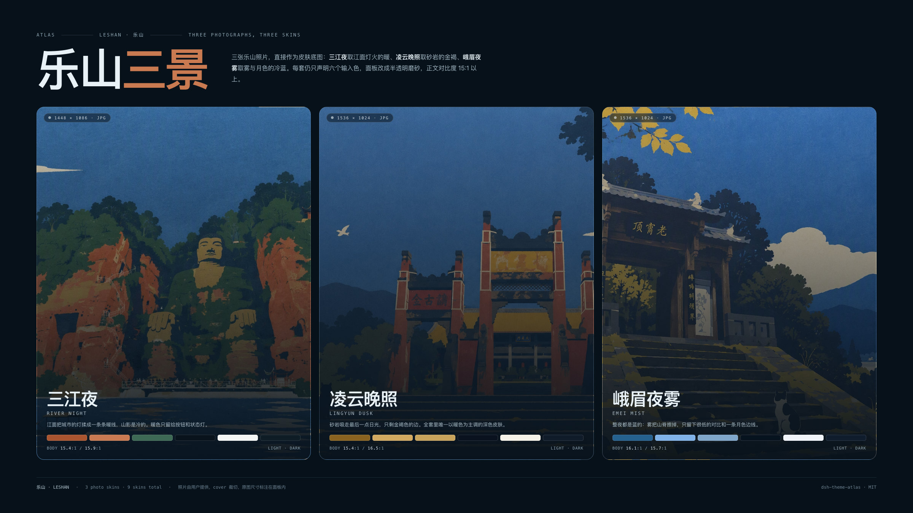
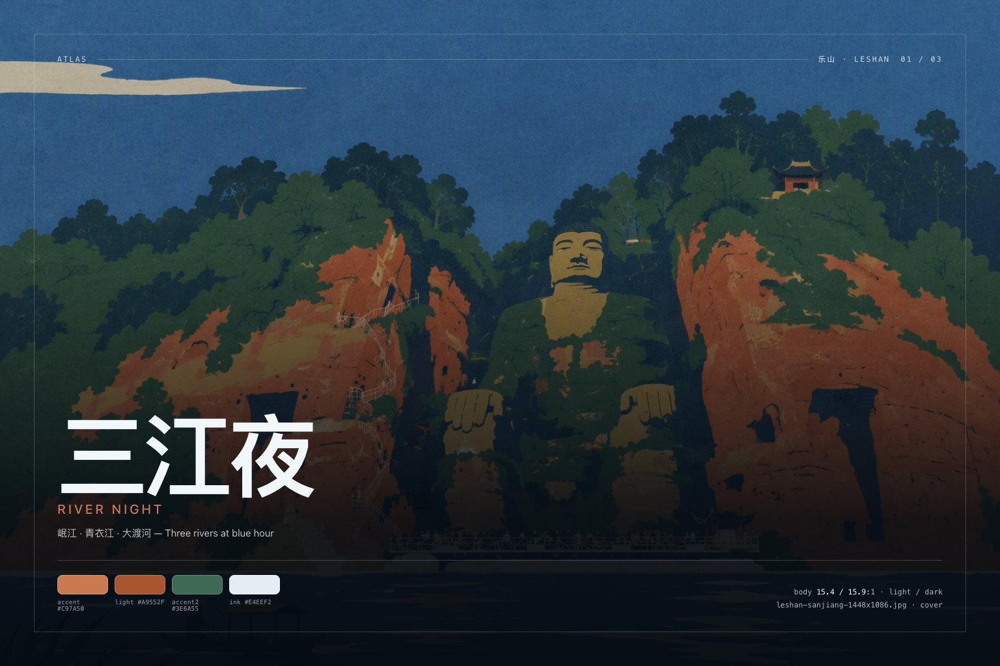

# dsh-theme-atlas

**DeepSeek Harness 网页端的九套皮肤：六套材质研究 + 三套乐山照片皮肤。一个 token 引擎，深浅双版，应用内切换。**

[English](./README.md) · [主题文档](./docs/themes.md) · [色板参考](./docs/palettes.md) · [图片尺寸](./docs/images.md)



Atlas 不是一个换色的皮肤，而是一组皮肤。每套皮肤只声明六个输入色（每种外观各一组），引擎据此推导 Web 外壳读取的 119 个 `--dsw-*` 别名 token，再对结果做对比度测量。九套 × 深浅两版 = 十八份色板，共用同一套语义：浅色下能看清的状态色，深色下同样成立。

包内分成两个系列：

- **材质研究**：抽象材质（玉、陶、极光、深海、樱、纸），靠颜色气候和签名氛围区分。
- **乐山**：三张作者提供的照片，直接作为整屏壁纸。照片之上的面板转成半透明磨砂（surface token 带 alpha），罩层随外观取 0.74（深）／0.86（浅），正文对比度保持在 15:1 以上。

## 九套皮肤

| 皮肤 | 材质 | 主色（浅 / 深） | 正文对比度 | 预览 |
| --- | --- | --- | --- | --- |
| **墨玉 Ink Jade** | 和田青玉 · 宣纸 | `#2E6B57` / `#74C3A2` | 15.6:1 / 16.0:1 | [浅色](./assets/screenshots/01-ink-jade-light-1600x1000.jpg) |
| **赤陶 Terracotta** | 未上釉的陶土 · 砂 | `#AE5229` / `#E08C5F` | 14.9:1 / 15.0:1 | [浅色](./assets/screenshots/02-terracotta-light-1600x1000.jpg) |
| **极光 Aurora** | 极地冰晶 · 夜光 | `#16758F` / `#55D6D2` | 15.5:1 / 16.3:1 | [浅色](./assets/screenshots/03-aurora-light-1600x1000.jpg) |
| **深海 Abyss** | 深海蓝 · 微光 | `#1B58B4` / `#5B8DEF` | 15.9:1 / 16.1:1 | [浅色](./assets/screenshots/04-abyss-light-1600x1000.jpg) |
| **樱雾 Sakura Mist** | 薄樱 · 雾面 | `#B1436B` / `#E78BA8` | 15.1:1 / 15.8:1 | [浅色](./assets/screenshots/05-sakura-light-1600x1000.jpg) |
| **素笺 Paper** | 无涂布纸 · 墨 | `#1F1F1F` / `#E8E8E8` | 17.9:1 / 16.9:1 | [浅色](./assets/screenshots/06-paper-light-1600x1000.jpg) |
| **三江夜 River Night** | 乐山 · 三江 | `#A9552F` / `#C97A50` | 15.4:1 / 15.9:1 | [浅色](./assets/screenshots/09-sanjiang-light-1600x1000.jpg) · [深色](./assets/screenshots/12-sanjiang-dark-1600x1000.jpg) |
| **凌云晚照 Lingyun Dusk** | 乐山 · 崖壁 | `#8A6320` / `#D3A961` | 15.4:1 / 16.5:1 | [浅色](./assets/screenshots/10-lingyun-light-1600x1000.jpg) |
| **峨眉夜雾 Emei Mist** | 乐山 · 雾与月色 | `#25618F` / `#7FB2E8` | 16.1:1 / 15.7:1 | [浅色](./assets/screenshots/11-emei-light-1600x1000.jpg) |

深色示例：[极光深色](./assets/screenshots/07-aurora-dark-1600x1000.jpg) · [素笺深色](./assets/screenshots/08-paper-dark-1600x1000.jpg) · [三江夜深色](./assets/screenshots/12-sanjiang-dark-1600x1000.jpg)。完整色板、token 表与实测对比度见 [docs/palettes.md](./docs/palettes.md)。

### 乐山 · Leshan



三张照片按原始分辨率入包，由外壳 cover 裁切。宿主半边通过 `/dsh-theme-atlas/wallpapers/<file>` 精确白名单路由提供（不可变缓存、支持 HEAD、304 协商）；没有 `webServer` 服务时，皮肤退回氛围渐变，功能不受影响。

| 皮肤 | 照片 | 原始尺寸 | 深色主视觉 | 浅色截图 |
| --- | --- | --- | --- | --- |
| 三江夜 River Night | `leshan-sanjiang-1448x1086.jpg` | 1448×1086 | `assets/keyart/sanjiang-1536x1024.jpg` | [截图](./assets/screenshots/09-sanjiang-light-1600x1000.jpg) |
| 凌云晚照 Lingyun Dusk | `leshan-lingyun-1536x1024.jpg` | 1536×1024 | `assets/keyart/lingyun-1536x1024.jpg` | [截图](./assets/screenshots/10-lingyun-light-1600x1000.jpg) |
| 峨眉夜雾 Emei Mist | `leshan-emei-1536x1024.jpg` | 1536×1024 | `assets/keyart/emei-1536x1024.jpg` | [截图](./assets/screenshots/11-emei-light-1600x1000.jpg) |

## 安装

```sh
# Web profile，直接从 GitHub 安装
dsh plugin --profile web add github:John-20260101/dsh-theme-atlas
```

Desktop：**插件 → 添加插件**，填入 `github:John-20260101/dsh-theme-atlas`，启用后按提示刷新窗口。

这是一个标准 bundle：`package.json` 声明了 `dsh.bundle` 与 `cordis.patch.yml`，`dsh plugin add` 可以直接加载；`client.js` 已预构建，不需要构建授权。

## 切换皮肤

- 点击窗口右下角的 **Atlas** 胶囊，或按 <kbd>Alt</kbd>+<kbd>K</kbd> 轮换。
- 选择保存在浏览器本地（`localStorage: dsh.theme-atlas.skin`），不同浏览器可以各用一套。
- 「隐藏此钮」隐藏胶囊（`dsh.theme-atlas.rail`）；快捷键仍然可用，清掉该键即可恢复。
- 深浅模式仍由外壳自己的「外观」设置决定——Atlas 两套色板都在，不覆盖你的偏好。

## 它做了什么

1. **Token 层**：加载时调用 `ctx.theme.overrideTokens('dsh-theme-atlas', layer)`，把每个 `--dsw-*` 别名 token 映射为 `{ light, dark }` 一对值。换肤即替换这一层；卸载插件即移除。外壳没有主题服务时，退化为同值的局部样式表。
2. **签名氛围**：一张插件自有样式表，按 `html[data-dsh-atlas]` 加页面渐变、选区色与焦点环，不碰任何布局。乐山系列用同一张表把照片铺在 `<body>` 上、按外观压一层罩层，并让推导出的 surface token 带 alpha，面板因此呈现磨砂质感。
3. **皮肤滑轨**：Shadow DOM 面板，外壳样式进不来，可键盘操作，随插件卸载一起移除。

除此之外不写任何东西：不写宿主设置、不落盘、不联网。

## 仓库里的图片

| 组 | 尺寸 | 数量 | 位置 |
| --- | --- | --- | --- |
| 商店截图 | 1600×1000（16:10） | 12 | [`assets/screenshots/`](./assets/screenshots) |
| 总览海报 / Banner | 2400×1350（16:9） | 2 | [`assets/screenshots/`](./assets/screenshots) — 材质、乐山 |
| 主视觉 | 1536×1024（3:2） | 9 | [`assets/keyart/`](./assets/keyart) |
| 乐山壁纸 | 原始 1448×1086 / 1536×1024 | 3 | [`assets/wallpapers/`](./assets/wallpapers) |
| 商店图标 | 1024 / 512 / 180 方形 | 3 | [`assets/`](./assets) |

尺寸、展示建议与重新生成命令见 [docs/images.md](./docs/images.md)；`screenshots.json` 把商店指向那八张界面截图。

## 兼容性

- DeepSeek Harness Web **0.2.0-rc.1 … 0.2.x**（`dsh.bundle` + `dsh.client`）。
- 官方 Desktop 与 `dsh web` 均可用；需要支持 `color-mix()` 的浏览器（Chromium 111+、Safari 16.2+）。
- 没有主题服务时，退化样式表仍会应用深浅两套色板。

## 开发

```sh
npm install
npm run verify   # 构建 + token 完整性 + WCAG 门槛
npm run shots    # 按文档尺寸重渲染全部图片
```

源码：`src/color.mjs`（色彩运算）、`src/tokens.mjs`（119 个 token 名契约）、`src/skins.mjs`（九套皮肤，每种外观六个输入色）、`src/derive.mjs`（角色推导 + 照片皮肤的磨砂面板模式）、`src/runtime.mjs`（token、壁纸与滑轨）、`index.js`（壁纸路由）。`client.js` 是生成物——改 `src/` 后跑 `npm run build`。

新增一套皮肤只需在 `src/skins.mjs` 加一行；`npm run verify` 会告诉你新色板是否过关。

## 许可

MIT。色板命名与文案为本仓库原创；`--dsw-*` token 名归 DeepSeek Harness 所有。
