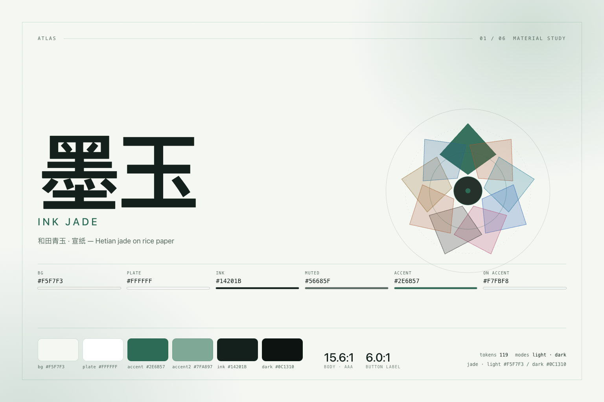
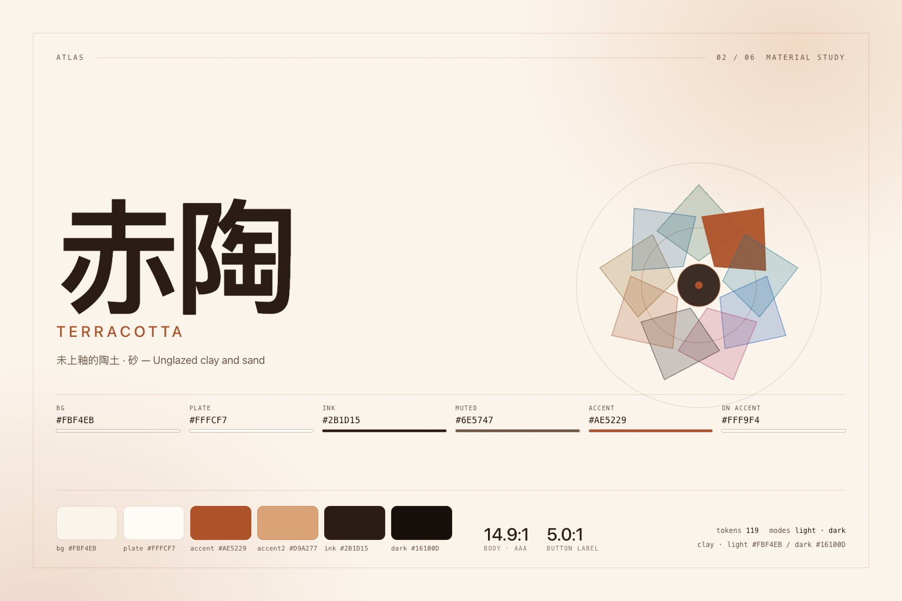
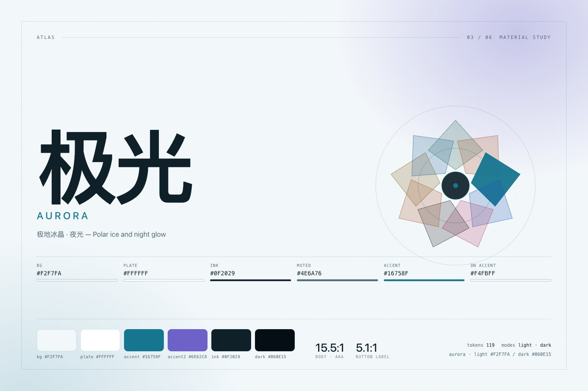
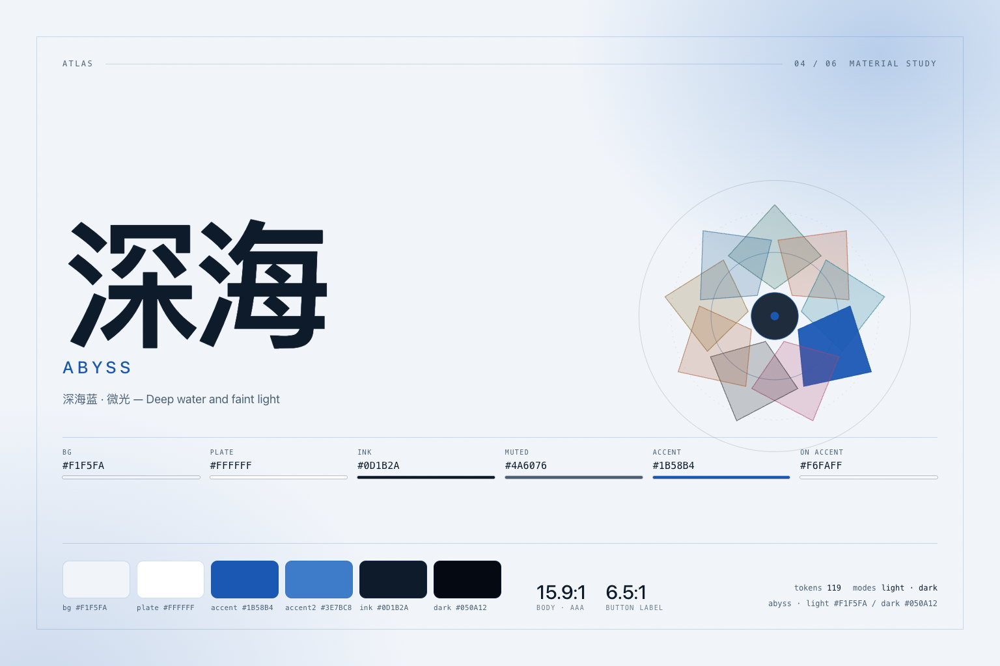
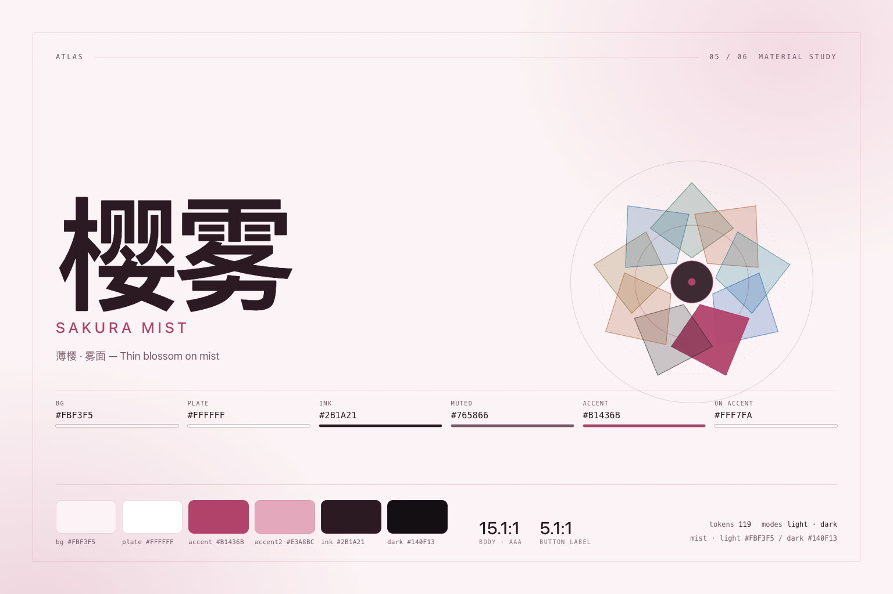
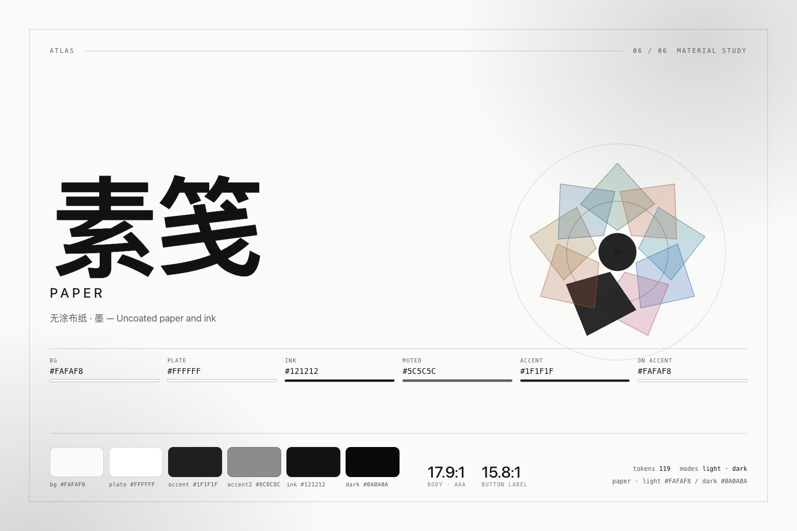
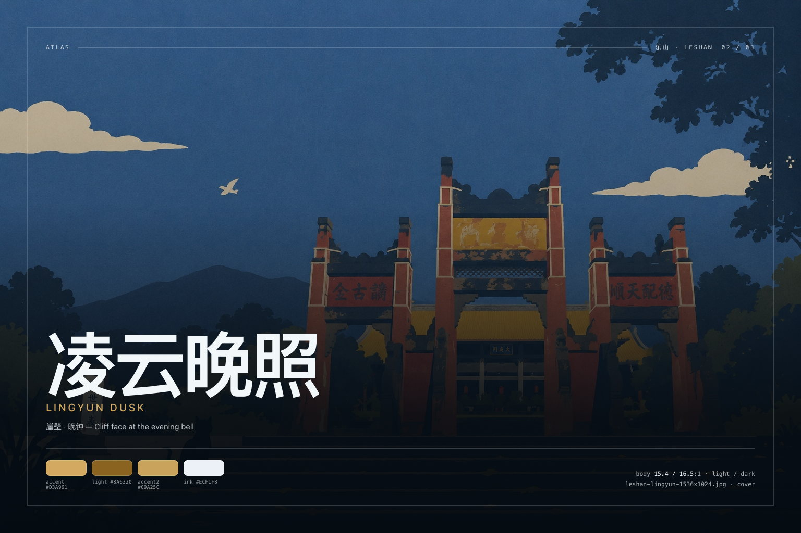
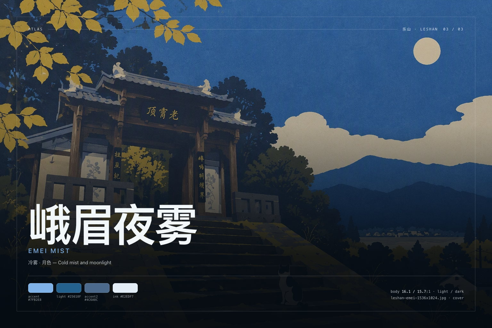

# Atlas theme document / 主题文档

> A pack of nine skins for the DeepSeek Harness Web GUI — six material studies and three Leshan photo skins.
> 九套皮肤的设计说明：设计原则、token 推导规则、照片皮肤的色彩与磨砂策略、扩展方式。
>
> Companion references: [palettes.md](./palettes.md) (every hex and every measured ratio) · [images.md](./images.md) (every image size) · [../README.md](../README.md) (install).

---

## 1. Why a pack, and why derived

Most DSH themes start from the stock palette and repaint a handful of tokens. That works until a component uses one of the tokens nobody repainted — then a menu, a diff gutter or a warning label stays stock blue inside an otherwise ochre interface. The failure is structural: a hand-painted palette has no rule that says *what belongs to what*.

Atlas is built the other way round. A skin is **six colour inputs per appearance** — page, plate, ink, muted ink, accent, and the ink that sits on the accent — plus two state hues. Everything the shell reads is derived from those by role. That gives three properties worth stating plainly:

1. **Completeness is checkable.** The 119 `--dsw-*` alias tokens are a checked contract (`src/tokens.mjs`); the build fails if a derivation misses one or invents one.
2. **Semantics survive the skin.** `state-error-*` is always the error hue, `bg-mask-*` always darkens, `label-caption` is always quieter than `label-secondary`. Switching skins changes the climate, not the grammar.
3. **Contrast is measured, not judged by eye.** `npm run verify` recomputes WCAG ratios for every skin and appearance and fails below the advertised floors.

The visible result: a theme can be described in one sentence (“jade grey on warm paper”), and that sentence still holds on the settings page, in a diff, in a toast and in the composer.

---

## 2. Design principles

**Material first, fashion second.** Each skin is named after a material and is built from that material's relationship between paper, pigment and accent — not from a hue that happens to be trending. 素笺 has almost no chroma; 极光 has two. Both are complete. The Leshan series extends the same rule to a photograph: the picture is the material, and the skin is built from what it is made of (water light, sandstone, mist).

**One temperature per skin.** A skin does not mix a warm page with a cool accent without a reason. Where two hues appear (Aurora's teal and violet, Sakura's rose and dust), the second hue is confined to the signature wash and the rail swatch — never to a semantic token.

**Quiet chrome, loud content.** Surfaces stay within a narrow band around the page colour; accents are reserved for interaction and state. This is why the skins differ dramatically in feel while looking calm in a screenshot.

**Nothing irreversible.** Every effect is plugin-owned and disposed on unload: token layer, signature stylesheet, rail. Turning Atlas off returns the stock UI without a reload.

---

## 3. The input roles

| Input | Role | Used for |
| --- | --- | --- |
| `bg` | page paper | `bg-base`, `bg-layer-1`, mask composites |
| `plate` | raised plate | `bg-layer-2`, cards, menus, composer |
| `ink` | primary ink | body text, hairlines (as alpha), brand |
| `muted` | secondary ink | captions, metadata, placeholders |
| `accent` | pigment | primary buttons, links, active nav, focus ring |
| `onAccent` | ink on pigment | button labels, `label-primary-foreground` |
| `danger` / `success` / `warn` | states | error, success, warning triads |
| `accent2` | atmosphere only | signature wash, rail swatch, key art |

`accent2` is deliberately *not* a shell token: a second hue must never leak into a semantic slot.

### Derivation families

| Family | Rule |
| --- | --- |
| Layers | `layer-2 = plate`; `layer-3` and `overlay` step 2.8% (light) / 5.5% (dark) toward white or black |
| Hairlines | `alpha(ink, 0.07 … 0.24)`, ×1.2 in dark, ×1.45 on 素笺 where shadow cannot separate surfaces |
| Text | `primary` = ink hardened to ≥7:1; `secondary` ≥4.5:1; `tertiary` ≥3:1; `caption` ≥3:1; `dimmed` stays decorative |
| Accent | hue hardened to ≥3:1 as a fill and ≥4.5:1 as text; hover steps 7–8% away from the page |
| Masks | black at 0.32 / 0.14 / 0.30 in light, 0.55 / 0.24 / 0.70 in dark |
| State tints | `tertiary` = state hue at 11–18% alpha, never a new hue |
| Code / markdown | page mixed 3–10% toward ink, so code blocks read as paper, not as a second theme |
| Diff | added/deleted = success/error at low alpha, markers at full strength |

The full derivation is `src/derive.mjs`; the resulting tables are [palettes.md](./palettes.md).

### Contrast policy

| Role | Floor | Basis |
| --- | --- | --- |
| Body text (`label-primary`) | 7.0:1 | WCAG AAA, long reading |
| Secondary text | 4.5:1 | WCAG AA |
| Accent as text (`state-business-primary`, `link`) | 4.5:1 | links and active nav must not rely on hue alone |
| Accent as fill vs page | 3.0:1 | non-text contrast for controls |
| Button label on fill | 4.5:1 | AA for the most-used control |
| Caption / metadata | 3.0:1 | small type stays legible without shouting |

Measured values for all eighteen palettes are in [palettes.md](./palettes.md). The gate that produced them is `scripts/verify.mjs`, also run by CI.

### Photo skins: frosted plates

A wallpaper skin adds one field to the same six inputs:

```js
wallpaper: { file: 'leshan-sanjiang-1448x1086.jpg', focus: 'center 55%', width: 1448, height: 1086 }
```

Three things change, and only three:

1. **Surface tokens carry alpha.** Layers, inputs, menus, bubbles and code blocks are emitted as `rgba()` at 0.78–0.94 instead of opaque, so the photograph is visible through every panel. The page (`bg-base`) stays opaque; the photograph lives on `<body>` under the scrim.
2. **The scrim is appearance-keyed.** Light uses 0.86 → 0.90 over the page colour, dark 0.74 → 0.82. Light mode deliberately reads as a milky haze; the photo is texture, not the subject. Dark mode lets the photograph lead.
3. **Photographs are served, not embedded.** The host half exposes `/dsh-theme-atlas/wallpapers/<file>` as an exact-file whitelist (GET/HEAD, strong ETag, immutable cache, 304). Without `webServer` the route is absent and the browser half falls back to the wash — no broken image, no layout shift.

Because the scrim composites to very nearly the palette's own page colour, the contrast numbers computed against `bg` remain representative; the gate still runs on the palette, and the screenshots verify the real composite.

---

## 4. The material studies

### 墨玉 · Ink Jade
*和田青玉 · 宣纸 / Hetian jade on rice paper*



Jade grey pressed into warm paper. The page keeps the warmth of 宣纸 (±2° hue around neutral) while the pigment is a desaturated jade; the result reads cool without turning the whole window cold. The signature wash puts a faint jade pool at the top-left and a colder one at the bottom-right, so the sidebar and the conversation sit in different light.

Best for: daylight work, long code reading. Contrast 15.6:1 / 16.0:1.

### 赤陶 · Terracotta
*未上釉的陶土 · 砂 / Unglazed clay and sand*



Kiln-fired ochre over sandy paper. The accent is deliberately brick rather than orange — it survives being used as a 1px active-nav bar without glowing. Plate is warmer than the page, which makes cards feel like paper laid on paper rather than floating glass.

Best for: writing-heavy sessions, afternoon light. Contrast 14.9:1 / 15.0:1.

### 极光 · Aurora
*极地冰晶 · 夜光 / Polar ice and night glow*



The only skin with two strong hues: teal pigment and a violet atmosphere. In dark mode the violet lives almost entirely in the wash, so semantic colour stays teal and the interface never turns “purple theme”. The light appearance is the pack's coolest page (blue-grey paper) without becoming a blue theme.

Best for: dark rooms, demos, anything that should feel alive. Contrast 15.5:1 / 16.3:1.

### 深海 · Abyss
*深海蓝 · 微光 / Deep water and faint light*



Blue pushed almost to black, with only the states still lit. The accent is brighter in dark than in light (a rare inversion, and the reason `accent` is hardened per appearance rather than once). Status colours are the only saturated things on screen, which makes a running tool call easy to spot from across the room.

Best for: night work, low-light rooms. Contrast 15.9:1 / 16.1:1.

### 樱雾 · Sakura Mist
*薄樱 · 雾面 / Thin blossom on mist*



Pink kept at mist strength. The trap with rose themes is sweetness; here the pigment is closer to a wine stain than to candy, the page is a warm off-white, and the second hue is a dust rose used only in the wash. Light mode is the intended appearance, dark is a night translation rather than an inversion.

Best for: light mode, editorial reading. Contrast 15.1:1 / 15.8:1.

### 素笺 · Paper
*无涂布纸 · 墨 / Uncoated paper and ink*



Ink and paper only — no chromatic accent at all. Because there is no hue to carry hierarchy, the skin leans on grammar: hairlines are 45% firmer, shadows shallower, radii unchanged. The primary button is black (light) or white (dark), which is the most honest possible “accent” for this idea.

Best for: comparative reading, screenshots, printing. Contrast 17.9:1 / 16.9:1.

---

## 5. The Leshan series

Three photographs, provided by the author, each carrying its own palette. They share a structure — photograph on `<body>`, translucent plates above it, one warm or cool accent — but not a mood: one is warm-led, one gold-led, one cold-led.

The photographs are used at native resolution (1448×1086 and 1536×1024) and cover-cropped by the shell, so the pack ships three JPEGs rather than a wall of re-encoded sizes.

### 三江夜 · River Night
*岷江 · 青衣江 · 大渡河 / Three rivers at blue hour*


Warm lantern light smeared across a cold river. The accent is the lantern's terracotta, the second hue is the hill green; everything else is blue-hour navy. This is the warmest of the three and the one that reads best as a full-bleed image.

Contrast 15.4:1 / 15.9:1. Preview: [light](../assets/screenshots/09-sanjiang-light-1600x1000.jpg) · [dark](../assets/screenshots/12-sanjiang-dark-1600x1000.jpg).

### 凌云晚照 · Lingyun Dusk
*崖壁 · 晚钟 / Cliff face at the evening bell*



Sandstone holding the last of the daylight: gold-brown accent on navy, the only warm-led dark skin in the pack. In light mode the page turns to a warm paper so the photograph does not fight it.

Contrast 15.4:1 / 16.5:1. Preview: [light](../assets/screenshots/10-lingyun-light-1600x1000.jpg).

### 峨眉夜雾 · Emei Mist
*冷雾 · 月色 / Cold mist and moonlight*



Blue all night: the mist erases the ridge, the palette keeps a very low temperature and a thin moonlit accent. The coolest of the three, and the one closest to the pack's 深海 skin in temperature but far softer in contrast.

Contrast 16.1:1 / 15.7:1. Preview: [light](../assets/screenshots/11-emei-light-1600x1000.jpg).

## 6. Appearance behaviour

- Atlas ships both palettes in one token layer (`{ light, dark }` per token) and lets the shell decide. It never calls `setTheme`.
- The signature wash reads the *active* appearance through `html[data-dsh-atlas-mode]` and the shell's `body[data-ds-dark-theme]` attribute, so the atmosphere follows your Appearance setting without a reload.
- Switching skins is instantaneous: the previous override is disposed and the new layer is registered in the same tick.
- Wallpaper skins re-key their scrim on the same appearance change, so switching light/dark moves the photograph from "haze" to "subject" without a reload.

## 7. Adding a skin

```js
// src/skins.mjs
{
  id: 'basalt',
  name: { zh: '玄武岩', en: 'Basalt' },
  material: { zh: '玄武岩 · 火山灰', en: 'Basalt and ash' },
  story: { zh: '……', en: '…' },
  swatch: ['#3A3F41', '#8B9497', '#F2F2F0'],
  signature: 'plain',           // or jade / clay / aurora / abyss / mist / paper / wallpaper
  // wallpaper: { file, focus, width, height },   // only for photo skins
  light: { bg, plate, ink, muted, accent, onAccent, danger, success, warn, accent2 },
  dark:  { … },
}
```

Then:

```sh
npm run verify   # token completeness + contrast gate
npm run shots    # re-render the preview and key art at the documented sizes
```

The gate reports the measured ratios; if a floor fails it names the skin and the role, so the fix is a colour change rather than a guessing game.

## 8. Known limits

- The engine derives from six roles; it cannot express a skin that needs two *semantic* accents (for example a product that wants blue for links and violet for selection). That is a deliberate constraint.
- `color-mix()` is required for the signature wash. On an older browser the wash drops out and the token layer still applies.
- The rail is a floating control. It is hidden by default only after you ask it to be; there is no settings-page surface yet.
- Preview screenshots are rendered from a static reconstruction of the shell ([`preview/`](../preview)), not captured from a live window; they are accurate for colour and layout grammar, not pixel-identical to your build.
- Photo skins depend on the host serving `assets/wallpapers`; a host without `webServer` gets the wash-only version. The photographs are cover-cropped, so a very wide window shows less of the frame than the key art does.
- Light appearance keeps the photograph faint on purpose. If a photo skin should lead in daylight, that needs a per-skin scrim override, not a global change.
